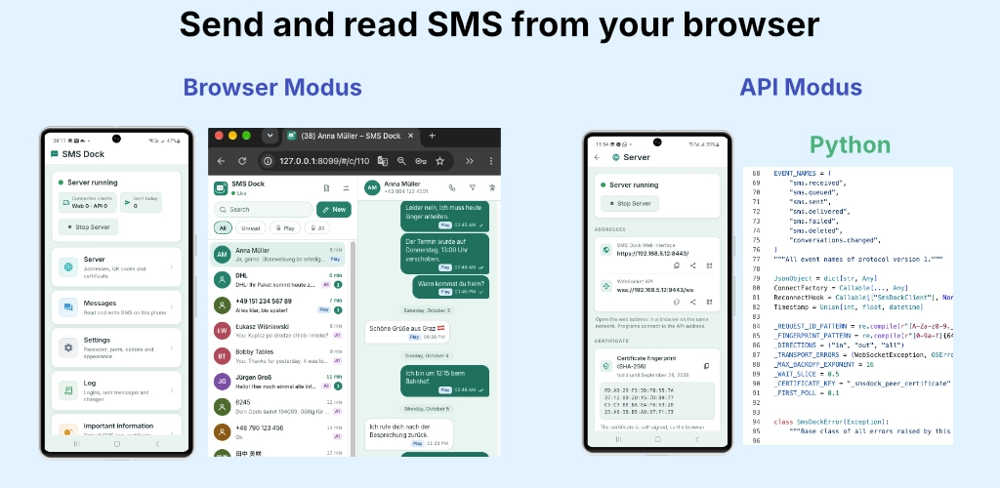

# SMS Dock: WebSocket API and clients



## App Store

[Google Play Store](https://play.google.com/store/apps/details?id=app.flutterdev.smscenter)

SMS Dock is an Android app that turns a phone into an SMS hub. The phone
keeps its SIM and its number; programs and browsers in the same network use
it to read, send and delete SMS and to react to incoming ones.

The app offers two interfaces:

| Interface | Default port | Address | For |
| --- | --- | --- | --- |
| Web interface | 8443 | `https://192.168.1.50:8443/` | People, in a browser |
| WebSocket API | 9443 | `wss://192.168.1.50:9443/ws` | Programs |

Both ports can be changed in the settings of the app. Both use the same
self-signed certificate and the same password.

This repository documents the WebSocket API and contains clients for it in
Python, Java, Go, Rust, Node.js, Dart and C#.

| File | Content |
| --- | --- |
| [API.md](API.md) | The protocol (version 1): actions, events, objects, errors, close codes, limits |
| [asyncapi.yaml](asyncapi.yaml) | The same protocol as an AsyncAPI 3.0 document, for tools |
| [python/](python/README.md) | Python library `smsdock`, command-line tool `smsdock`, examples, tests |
| [java/](java/README.md) | The same for Java |
| [go/](go/README.md) | The same for Go |
| [rust/](rust/README.md) | The same for Rust |
| [nodejs/](nodejs/README.md) | The same for Node.js |
| [dart/](dart/README.md) | The same for Dart |
| [csharp/](csharp/README.md) | The same for C# (.NET) |

The seven clients offer the same functions, and their command-line tools
take the same commands and options and print the same output. The quick
start below uses the Python client; the README of each other client shows
how to build and use it.

## Quick start

You need the phone and a computer in the same network, and Python 3.9 or
newer on the computer.

### 1. Prepare the app

1. Set a password in the app (at least 6 characters).
2. Start the server.
3. Open the Server screen. Note the address of the API, for example
   `wss://192.168.1.50:9443/ws`, and keep the screen open: it shows the
   fingerprint of the certificate.

### 2. Install the Python client

```bash
git clone <URL of this repository> smsdock
cd smsdock/python
python3 -m venv .venv
source .venv/bin/activate
python3 -m pip install -e .
```

### 3. Check the fingerprint

The certificate of the phone is self-signed, so the client cannot verify
it the usual way. It pins the certificate instead: it accepts only the
certificate with the fingerprint you give it.

Ask the server for its fingerprint:

```bash
smsdock fingerprint 192.168.1.50
```

```
A1:B2:C3:D4:E5:F6:07:18:29:3A:4B:5C:6D:7E:8F:90:A1:B2:C3:D4:E5:F6:07:18:29:3A:4B:5C:6D:7E:8F:90
```

**Compare the output with the fingerprint on the screen of the phone.** Go
on only if both are the same. If they differ, something between your
computer and the phone answers in its place.

Store the fingerprint and the password in the environment:

```bash
export SMSDOCK_FINGERPRINT='A1:B2:C3:D4:E5:F6:07:18:29:3A:4B:5C:6D:7E:8F:90:A1:B2:C3:D4:E5:F6:07:18:29:3A:4B:5C:6D:7E:8F:90'
export SMSDOCK_PASSWORD='your password'
```

### 4. List messages

The last 10 incoming SMS:

```bash
smsdock messages wss://192.168.1.50:9443/ws --direction in --limit 10
```

```
ID    TIME              DIR  NUMBER          NAME          STATUS    TEXT
2807  2026-09-29 12:50  in   +436641234567                 received  STATUS
2805  2026-09-29 09:45  in   +4369087654321  Ben Example   received  Thanks!
2803  2026-09-29 08:15  in   +4369912345678  Anna Example  received  Great, see you then.
```

### 5. Send a message

```bash
smsdock send wss://192.168.1.50:9443/ws \
  --to +4369912345678 --text 'All systems running.' --wait
```

```
Sent: +4369912345678, 1 part(s), requestId e2784e0c831a42aa842da84c43a49da9
```

### 6. React to incoming messages

Print every SMS as it arrives:

```bash
smsdock listen wss://192.168.1.50:9443/ws
```

The same in Python, with your own code as the hook:

```python
from smsdock import SmsDockClient

# Password and fingerprint come from SMSDOCK_PASSWORD and SMSDOCK_FINGERPRINT.
with SmsDockClient("wss://192.168.1.50:9443/ws") as dock:
    dock.subscribe("sms.received")
    for event in dock.events():
        message = event["data"]["message"]
        print(message["address"], message["body"])
        if message["body"].strip().upper() == "STATUS":
            dock.send(message["address"], "All systems running.")
```

Do not run this loop as it is: it answers every sender every time. See
[python/examples/auto_reply.py](python/examples/auto_reply.py) for a hook
with guards against reply loops.

More commands, the library and the examples are described in
[python/README.md](python/README.md).

## Without a client

The API is plain JSON over a WebSocket; any language with a WebSocket
library over TLS can use it. The exchange for the last 10 incoming SMS:

```json
{"event":"hello","protocolVersion":1,"authenticationRequired":true}
```

```json
{"id":"1","action":"authenticate","password":"your password"}
```

```json
{"id":"1","ok":true,"result":{"protocolVersion":1,"app":{"name":"SMS Dock","version":"1.0.0","protocolVersion":1},"latestSeq":42,"epoch":1790672000000}}
```

```json
{"id":"2","action":"messages.list","direction":"in","limit":10}
```

```json
{"id":"2","ok":true,"result":{"items":[],"nextCursor":null}}
```

Compare the fingerprint of the certificate before you send the password.
[API.md](API.md) has the details.

## Security

- **Use it in your own network only.** Do not expose the ports 8443 and
  9443 to the internet: no port forwarding on the router, no public
  address. Whoever reaches the API and knows the password can read your
  SMS, including one-time codes, and send SMS at your expense. Use a VPN
  into your network if you need access from outside.
- **Pin the certificate.** The certificate is created on the phone at the
  first start and never leaves it. It names no host, so clients compare
  its SHA-256 fingerprint with the one the app shows. Do not switch off
  certificate verification without pinning; the password would go to
  anyone who answers at that address.
- **The fingerprint changes** when you use "Regenerate certificate" in the
  app or reinstall the app. Clients then refuse to connect until they get
  the new fingerprint. If the fingerprint changes without such a reason,
  do not accept the new one.
- **Keep the password out of command lines.** Command lines show up in the
  process list and in the shell history. The clients read the password
  from the environment variable `SMSDOCK_PASSWORD` and have no option
  for it.
- **Wrong passwords lock the login.** After 5 wrong passwords (web
  interface and API together) logins are locked for 30 seconds, doubling
  up to 15 minutes.
- **Requests are limited** to 20 per second per connection. The clients
  wait and repeat a request that was refused for this reason.
- **Choose a long password.** It is the only thing between your network
  and your SMS.

## Licence of the app

| | Free version | Full licence |
| --- | --- | --- |
| Web interface | Yes | Yes |
| Sending | At most 10 SMS per day, through the web interface | No limit by the app |
| WebSocket API | No | Yes |

The API needs the full licence, which is bought in the app. Without it the
login fails with the error `licence_required` and the server closes the
connection with code 4403.

## Limitations

- SMS only. MMS and RCS messages are neither shown nor sent.
- Group threads are not supported. A conversation is the list of messages
  exchanged with one number.
- A message has at most 10 SMS parts: 1530 plain or 670 Unicode
  characters.
- The phone sends at most 20 SMS parts per minute.
- At most 8 API clients can be connected at once.
- Events are not sent again. What happens while a client is not
  connected is lost for it; read the messages with `messages.list` after
  reconnecting. `latestSeq` and `epoch` in the answer to `authenticate`
  tell whether anything happened and whether the app was restarted.
- Marking messages as read needs SMS Dock to be the phone's default SMS
  app.
- Delivery reports (`sms.delivered`) depend on the mobile network. Some
  networks never send them.
- Deleting removes a message from the phone only while SMS Dock is the
  phone's default SMS app. Otherwise the message is hidden in SMS Dock
  and stays on the phone (`deleteMode` in `status`).

## Documentation

- [API.md](API.md): the protocol
- [asyncapi.yaml](asyncapi.yaml): the protocol for tools, for example
  `npx @asyncapi/cli validate asyncapi.yaml`
- [python/README.md](python/README.md): the Python client
- [java/README.md](java/README.md): the Java client
- [go/README.md](go/README.md): the Go client
- [rust/README.md](rust/README.md): the Rust client
- [nodejs/README.md](nodejs/README.md): the Node.js client
- [dart/README.md](dart/README.md): the Dart client
- [csharp/README.md](csharp/README.md): the C# client

## Development

The tests of the clients need no phone. Each client brings a fake server
that speaks the protocol of API.md:

| Client | Run the tests |
| --- | --- |
| Python | `cd python && python3 -m pip install -e . pytest && python3 -m pytest` |
| Java | `cd java && mvn verify` |
| Go | `cd go && go test ./...` |
| Rust | `cd rust && cargo test` |
| Node.js | `cd nodejs && npm install && npm test` |
| Dart | `cd dart && dart pub get && dart test` |
| C# | `cd csharp && dotnet test` |
